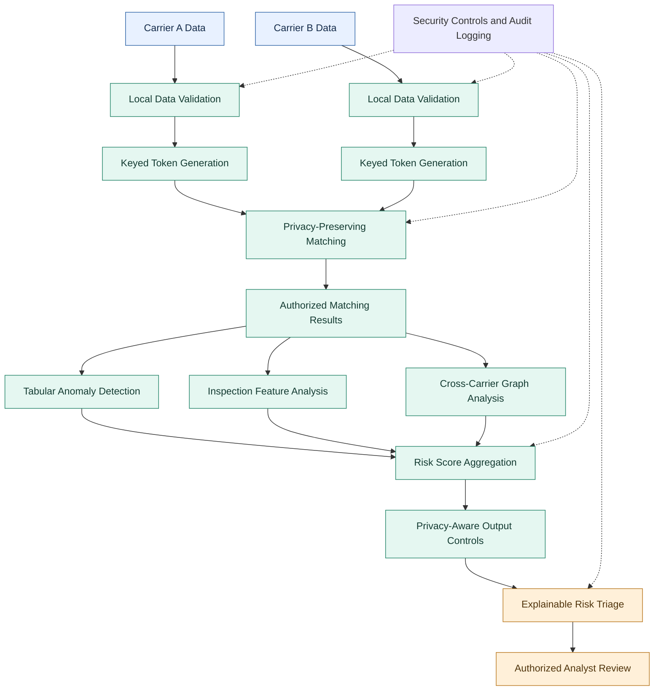

# 🛡️ CargoLens: Zero-Trust Multimodal Contraband & Trade Anomaly Scanner

<div align="center">

**Privacy-Preserving Maritime Cargo Intelligence with Multimodal AI**

[](https://community.ibm.com/)
[](https://www.ibm.com/)
[](https://www.python.org/)
[](https://www.ibm.com/products/linuxone)
[](https://www.ibm.com/security)

*A privacy-preserving cargo intelligence platform designed to help maritime carriers and customs authorities identify suspicious trade patterns, potential contraband indicators, and cross-carrier anomalies without unnecessarily exposing proprietary commercial information.*

</div>

---

## 📌 Table of Contents

- [Overview](#-overview)
- [Problem Statement](#-problem-statement)
- [Our Solution](#-our-solution)
- [Key Features](#-key-features)
- [System Architecture](#-system-architecture)
- [Zero-Trust Security Model](#-zero-trust-security-model)
- [AI and Anomaly Detection](#-ai-and-anomaly-detection)
- [Mathematical Formulation](#-mathematical-formulation)
- [Technology Stack](#-technology-stack)
- [Repository Structure](#-repository-structure)
- [Installation and Setup](#-installation-and-setup)
- [Execution Guide](#-execution-guide)
- [Evaluation and Testing](#-evaluation-and-testing)
- [Dashboard and Visualizations](#-dashboard-and-visualizations)
- [IBM LinuxONE Deployment Strategy](#-ibm-linuxone-deployment-strategy)
- [Privacy, Limitations and Responsible Use](#-privacy-limitations-and-responsible-use)
- [Future Enhancements](#-future-enhancements)
- [IBM Z Datathon 2026](#-ibm-z-datathon-2026)
- [Contributing](#-contributing)
- [License](#-license)

---

## 🌍 Overview

**CargoLens** is a proposed zero-trust, multimodal cargo intelligence system for privacy-preserving maritime trade anomaly detection.

International shipping networks process enormous volumes of cargo declarations, shipment records, port movements, and inspection data. A single carrier may observe only a small portion of a suspicious trade route, while another carrier may hold complementary information.

Traditional cross-organizational investigations can require sharing sensitive information, including:

- Proprietary freight rates and shipping contracts.
- Customer and supplier identities.
- Commercially sensitive shipment records.
- Port-to-port transportation patterns.
- Internal operational and logistics data.

CargoLens aims to address this challenge by combining privacy-aware data processing with machine learning, explainable anomaly scoring, and controlled information sharing.

The system is designed around four major stages:

1. **Privacy-preserving matching:** Identify relevant shared trade corridors using keyed cryptographic tokens.
2. **Multimodal anomaly detection:** Analyze structured trade data, inspection indicators, and cross-carrier relationships.
3. **Privacy-aware risk aggregation:** Apply a configurable differential privacy mechanism where its assumptions are satisfied.
4. **Explainable customs triage:** Produce prioritized Green, Amber, and Red review categories for human investigation.

The objective is not to automatically declare a shipment illegal. CargoLens is designed to help authorized analysts identify shipments that warrant further examination.

> **Project status:** Replace this notice with the actual implementation status before submission. Distinguish implemented components, tested prototypes, simulated security controls, and planned infrastructure integrations.

---

## 🚨 Problem Statement

### The challenge

Maritime trade anomaly detection is difficult because information is distributed across different carriers, ports, customs systems, and inspection platforms.

A suspicious shipment may appear normal when examined individually. However, combining multiple indicators may reveal unusual behavior, such as:

- Unexpected trade routes or transshipment patterns.
- Inconsistent shipment quantities and declared commodity categories.
- Unusual statistical relationships between cargo weight and shipment characteristics.
- Repeated relationships between otherwise unrelated trading entities.
- Differences between structured cargo declarations and available inspection indicators.
- Potentially suspicious cross-carrier activity.

### Existing limitations

| Challenge | Consequence | CargoLens approach |
|---|---|---|
| Fragmented trade information | Investigators lack a complete picture | Privacy-aware cross-carrier matching |
| Sensitive commercial records | Organizations may resist sharing data | Minimize exposure of raw records |
| Single-modality analysis | Important patterns may be overlooked | Combine tabular, visual, and graph indicators |
| Black-box risk predictions | Difficult to justify an investigation | Explainable anomaly indicators |
| Excessive alerts | Analysts waste time on low-value cases | Configurable risk prioritization |
| Centralized data exposure | A breach may reveal sensitive records | Defense-in-depth security architecture |

---

## 💡 Our Solution

CargoLens introduces a layered intelligence pipeline that combines cryptographic matching, machine learning, inspection-data analysis, and controlled alert generation.

### Stage 1 — Privacy-Preserving Trade Matching

Each participating carrier can derive keyed tokens from agreed-upon identifiers, such as normalized port and trade-corridor codes.

The tokens support matching without directly exchanging the original identifiers through the matching interface.

### Stage 2 — Multimodal Anomaly Detection

The analysis layer evaluates multiple independent signals:

- **Tabular intelligence:** Detect unusual combinations of shipment attributes.
- **Inspection intelligence:** Analyze authorized inspection measurements and image-derived features when available.
- **Graph intelligence:** Identify unusual relationships between shipment entities and trade corridors.

### Stage 3 — Privacy-Aware Risk Aggregation

The pipeline combines normalized anomaly indicators into a configurable risk score. A differential privacy mechanism may be applied to appropriate shared outputs when the privacy budget, sensitivity, contribution bounds, and threat model are explicitly defined.

### Stage 4 — Explainable Customs Triage

The output layer generates a prioritized review queue containing risk categories, contributing indicators, and available evidence references.

| Risk category | Suggested interpretation |
|---|---|
| 🟢 Green | No significant anomaly detected by the configured model |
| 🟠 Amber | Further review may be appropriate |
| 🔴 Red | Higher-priority review based on multiple anomaly indicators |

These categories are decision-support outputs, not proof of criminal activity. Thresholds must be calibrated and evaluated against representative validation data.

---

## 🏗️ System Architecture

CargoLens follows a modular architecture intended to support deployment on IBM LinuxONE infrastructure.

### Architecture diagram



### Architecture components

| Component | Responsibility |
|---|---|
| Carrier data adapters | Load and validate authorized data |
| Token generation | Derive keyed matching tokens |
| Matching engine | Identify common identifiers or corridors |
| Tabular detector | Analyze structured shipment attributes |
| Vision detector | Process available inspection features |
| Graph analyzer | Examine cross-carrier relationships |
| Risk aggregator | Combine normalized model outputs |
| Privacy layer | Apply validated output-protection mechanisms |
| Triage engine | Assign review categories and explanations |
| Audit layer | Record relevant processing and security events |

The architecture diagram describes the intended logical design. The actual implementation may use fewer components or simulated interfaces depending on the available dataset and execution environment.

---

## 🔐 Zero-Trust Security Model

CargoLens follows a zero-trust design principle: no participant, data source, or processing component should be trusted solely because it belongs to the system.

### Security objectives

- **Data minimization:** Process only the fields required for the analysis.
- **Separation of concerns:** Keep data ingestion, matching, inference, and output generation logically separate.
- **Cryptographic protection:** Use appropriate cryptographic primitives for token generation and integrity checks.
- **Access control:** Restrict access to authorized data, models, and output records.
- **Auditability:** Record relevant processing events without unnecessarily logging sensitive information.
- **Controlled disclosure:** Limit the detail exposed in cross-organizational results.
- **Reproducibility:** Document model parameters, dataset versions, and evaluation procedures.

### Keyed cryptographic matching

A simplified matching token can be derived using HMAC-SHA256:

```python
import hashlib
import hmac


def generate_trade_token(
    secret_key: bytes,
    port_code: str,
    corridor_id: str
) -> str:
    """
    Generate a deterministic keyed token for an agreed
    trade-corridor identifier.

    Keep secret_key confidential and outside source control.
    """
    normalized_port = port_code.strip().upper()
    normalized_corridor = corridor_id.strip().upper()

    message = (
        normalized_port + "|" + normalized_corridor
    ).encode("utf-8")

    return hmac.new(
        secret_key,
        message,
        hashlib.sha256
    ).hexdigest()
```

Example:

```python
key = b"replace-with-a-securely-managed-secret"

token = generate_trade_token(
    key,
    "INMUN",
    "CORRIDOR_001"
)

print(token)
```

**Important security considerations:**

- The example key is for demonstration only. Never use a hard-coded production secret.
- All parties must follow a defined key-management and normalization protocol.
- HMAC tokens are deterministic, so matching outputs may reveal equality relationships.
- HMAC tokenization alone is not a complete private set intersection protocol.
- If carriers do not share a trusted key, a more sophisticated PSI protocol or enclave-mediated key service may be required.
- A secure enclave must be configured and verified; running Python on LinuxONE does not automatically provide confidential computing.

---

## 🤖 AI and Anomaly Detection

CargoLens is designed to combine complementary anomaly indicators rather than rely on a single classifier.

### 1. Tabular anomaly detection

**Candidate model:** Isolation Forest.

Isolation Forest is an unsupervised machine learning algorithm that isolates unusual observations through randomized partitioning.

Potential features include:

- Shipment weight and volume.
- Declared cargo quantities.
- Commodity categories.
- Route and transit characteristics.
- Available inspection measurements.
- Historical deviations within comparable shipment groups.

Example:

```python
import pandas as pd
from sklearn.ensemble import IsolationForest

# Replace this example with the actual validated feature dataset.
features = pd.DataFrame({
    "weight": [100, 110, 95, 105, 500],
    "volume": [10, 11, 9, 10, 50],
    "transit_days": [4, 5, 4, 4, 20]
})

model = IsolationForest(
    n_estimators=200,
    contamination="auto",
    random_state=42
)

model.fit(features)

features["anomaly_label"] = model.predict(features)
features["anomaly_score"] = -model.decision_function(features)

print(features)
```

Interpretation:

- `anomaly_label = -1`: Flagged as anomalous by the model.
- `anomaly_label = 1`: Not flagged as anomalous by the model.
- Higher `anomaly_score` values indicate greater relative abnormality under this scoring convention.

An anomaly is not equivalent to a confirmed contraband shipment. Feature selection, scaling, missing-value handling, and contamination assumptions should be documented.

### 2. Inspection-image analysis

Where authorized X-ray or non-intrusive inspection images are available, CargoLens can extract image-derived features and compare them with suitable reference distributions.

Potential indicators include:

- Unusual density-related image patterns.
- Unexpected spatial distributions.
- Inconsistencies between declared cargo characteristics and inspection-derived features.
- Differences from comparable shipment classes.

A simple standardized deviation score can be used for a scalar measurement:

\[
Z_{\mathrm{vis}} =
\frac{|x-\mu_{\mathrm{ref}}|}
{\sigma_{\mathrm{ref}}+\epsilon}
\]

Where:

- \(x\) is the observed measurement.
- \(\mu_{\mathrm{ref}}\) is the reference mean.
- \(\sigma_{\mathrm{ref}}\) is the reference standard deviation.
- \(\epsilon\) is a small numerical stability constant.

This formula is appropriate only when the selected measurement and reference population support the comparison. A scalar score is not, by itself, a validated physical mass-attenuation model or a reliable method of identifying a specific chemical.

**Data requirement:** If suitable inspection images are unavailable, the vision component should be described as a planned extension or evaluated using explicitly labeled synthetic examples.

### 3. Cross-carrier graph analysis

CargoLens can represent relevant entities and relationships as a graph.

Example node types:

- Trade corridors.
- Ports.
- Shipment identifiers.
- Pseudonymous carrier-specific entities.
- Commodity categories.

Example edge types:

- Shipment follows corridor.
- Shipment transits port.
- Entity appears in an authorized shared matching result.

Potential graph indicators include:

- Unusually high connectivity.
- Unexpected route overlap.
- Repeated connections between otherwise unrelated groups.
- Abrupt changes in historical network patterns.

NetworkX can be used for graph construction and analysis:

```python
import networkx as nx

G = nx.Graph()

G.add_edge("PORT_A", "CORRIDOR_1")
G.add_edge("PORT_B", "CORRIDOR_1")
G.add_edge("PORT_A", "CORRIDOR_2")

degree_centrality = nx.degree_centrality(G)

print(degree_centrality)
```

Graph relationships should be based on authorized data, and entity identifiers should be pseudonymized where appropriate.

---

## 📐 Mathematical Formulation

### 1. Keyed matching

For a normalized identifier \(x_i\), define:

\[
\tau_i = \operatorname{HMAC}_{K}(x_i)
\]

For two token sets:

\[
\mathcal{T}_A = \{\tau_i^A\},
\qquad
\mathcal{T}_B = \{\tau_j^B\}
\]

Their common tokens are:

\[
\mathcal{I} = \mathcal{T}_A \cap \mathcal{T}_B
\]

This represents deterministic token matching under a compatible key and normalization protocol. It does not, by itself, establish a complete cryptographically secure PSI protocol.

### 2. Tabular anomaly score

Let \(S_t\) represent the normalized tabular anomaly score:

\[
S_t = g_{\mathrm{tabular}}(X)
\]

Here, \(X\) is the validated feature matrix and \(g_{\mathrm{tabular}}\) is the chosen anomaly detection model.

The model score must be calibrated or transformed to a documented scale before combining it with other signals.

### 3. Multimodal score fusion

Let:

- \(S_t\) = tabular anomaly score.
- \(S_v\) = vision anomaly score.
- \(S_g\) = graph anomaly score.
- \(w_t,w_v,w_g\) = nonnegative fusion weights.

A weighted score can be defined as:

\[
R = 100 \cdot
\operatorname{clip}
\left(
\frac{
w_tS_t+w_vS_v+w_gS_g
}{
w_t+w_v+w_g
},
0,1
\right)
\]

This expression assumes the input scores are calibrated to the interval \([0,1]\) and that the sum of weights is positive.

If a modality is unavailable, its weight should be handled explicitly rather than silently treating missing evidence as a normal result.

### 4. Differential privacy

The Laplace mechanism for a function \(f\) can be written as:

\[
\widetilde{f}(D)
=
f(D)+\operatorname{Lap}
\left(\frac{\Delta f}{\epsilon}\right)
\]

Where:

- \(D\) is the dataset.
- \(\Delta f\) is the global sensitivity of the function.
- \(\epsilon\) is the privacy parameter.
- \(\operatorname{Lap}(b)\) is zero-centered Laplace noise with scale \(b\).

A smaller \(\epsilon\) generally means stronger privacy protection but greater distortion.

A proposed setting such as \(\epsilon=1.2\) is a design parameter, not proof of a privacy guarantee. A valid guarantee requires a specified neighboring-dataset definition, bounded contributions, sensitivity analysis, and appropriate accounting for repeated releases.

---

## 🧰 Technology Stack

| Technology | Intended role |
|---|---|
| Python | Core implementation |
| pandas | Data cleaning and transformation |
| NumPy | Numerical operations |
| scikit-learn | Tabular anomaly detection and evaluation |
| NetworkX | Graph construction and analysis |
| Matplotlib | Evaluation visualizations |
| Jupyter Notebook | Interactive experimentation |
| HMAC-SHA256 | Keyed token generation |
| IBM LinuxONE | Target execution and infrastructure environment |
| PostgreSQL or CSV | Optional persistence and data exchange |

Only list technologies as implemented dependencies when they are actually used by the code in this repository.

---

## 📂 Repository Structure

```text
CargoLens/
│
├── README.md
├── requirements.txt
│
├── CargoLens_IBM_Z.ipynb
├── cargolens_engine.py
├── cargolens_solution_blueprint.pdf
│
├── data/
│   ├── README.md
│   ├── un_comtrade_trade_statistics.csv
│   ├── dgcis_india_port_cargo_movements.csv
│   └── cargolens_enclave_triage_output.csv
│
├── src/
│   ├── __init__.py
│   ├── preprocessing.py
│   ├── privacy_matching.py
│   ├── anomaly_detection.py
│   ├── graph_analysis.py
│   ├── risk_scoring.py
│   └── triage.py
│
├── tests/
│   ├── test_privacy_matching.py
│   ├── test_anomaly_detection.py
│   └── test_risk_scoring.py
│
├── screenshots/
│   ├── architecture.png
│   ├── anomaly_dashboard.png
│   └── evaluation_results.png
│
└── docs/
    ├── architecture.md
    ├── security_model.md
    └── evaluation_methodology.md
```

The structure above is a suggested layout. Remove entries for files or directories that do not exist in your actual GitHub repository.

### Dataset documentation

The project may use public trade statistics and authorized port movement datasets.

For every dataset, document:

- Original publisher and source URL.
- Download or retrieval date.
- License and usage conditions.
- Column descriptions and units.
- Missing-value treatment.
- Data cleaning and transformation steps.
- Whether the dataset contains real, anonymized, or synthetic records.

Do not upload restricted shipment data, private carrier records, credentials, or other confidential information.

---

## ⚙️ Installation and Setup

### Prerequisites

- Python 3.10 or later.
- Git.
- Jupyter Notebook or JupyterLab, if using the notebook.
- Access to the required dataset files.

IBM LinuxONE access is not required to run a local prototype. Any claim of deployment on `s390x` should be supported by an actual execution and compatibility test.

### Step 1 — Clone the repository

```bash
git clone https://github.com/YOUR_USERNAME/CargoLens.git
cd CargoLens
```

Replace `YOUR_USERNAME/CargoLens` with your actual GitHub repository path.

### Step 2 — Create a virtual environment

**Windows:**

```bash
python -m venv .venv
.venv\Scripts\activate
```

**Linux or macOS:**

```bash
python3 -m venv .venv
source .venv/bin/activate
```

### Step 3 — Install dependencies

Create a `requirements.txt` file containing the libraries used by your implementation. For the example algorithms in this README:

```text
numpy
pandas
scikit-learn
networkx
matplotlib
jupyter
```

Install the dependencies:

```bash
python -m pip install --upgrade pip
pip install -r requirements.txt
```

For reproducible submissions, record and test specific dependency versions after verifying the working environment.

---

## ▶️ Execution Guide

### Option A — Run the Jupyter notebook

```bash
jupyter notebook CargoLens_IBM_Z.ipynb
```

Open the notebook and execute the cells in order.

The notebook should document:

1. Dataset loading.
2. Data validation and preprocessing.
3. Feature engineering.
4. Token generation or matching simulation.
5. Anomaly detection.
6. Graph-based analysis, if implemented.
7. Risk score aggregation.
8. Evaluation and visualization.

### Option B — Run the standalone engine

If `cargolens_engine.py` exposes a standard Python entry point:

```bash
python cargolens_engine.py --help
```

Follow the available command-line arguments shown by the actual script.

For example, a future implementation could support:

```bash
python cargolens_engine.py --input data/sample_shipments.csv
```

Use this command only after the corresponding argument has been implemented.

---

## 🧪 Evaluation and Testing

CargoLens should be evaluated on detection quality, privacy controls, operational reliability, and interpretability.

### Suggested test cases

| Test case | Expected behavior |
|---|---|
| Valid structured records | Data passes schema validation |
| Missing required field | Record is rejected or handled by a documented policy |
| Duplicate records | Duplicate handling follows the configured policy |
| Unusual numeric features | Model returns a score without crashing |
| Empty dataset | Pipeline reports a clear validation error |
| Incompatible token keys | Matching compatibility failure is detected |
| Sensitive fields in logs | Logging controls prevent unintended disclosure |
| Invalid score weights | Risk aggregation rejects invalid configuration |
| Missing inspection modality | The system records the modality as unavailable |
| Invalid risk threshold | Configuration validation fails clearly |

### Running tests

If the project includes pytest tests:

```bash
pip install pytest
pytest -v
```

Do not claim all tests pass unless they have been run successfully in the submitted environment.

### Recommended evaluation metrics

**Anomaly detection**

- Precision.
- Recall.
- F1-score.
- ROC-AUC, where suitable ground-truth labels exist.
- Precision-recall curves for imbalanced datasets.
- False-positive rate.

**Operational performance**

- End-to-end processing time.
- Throughput by number of records.
- Peak memory consumption.
- Runtime on the target architecture.

**Privacy and security**

- Sensitive-field exposure checks.
- Key-handling and access-control tests.
- Token-matching correctness.
- Differential privacy assumptions and accounting.
- Tests for unintended information leakage.

If no labeled ground truth exists, use carefully described proxy evaluation or expert-reviewed examples instead of presenting synthetic metrics as real-world detection performance.

---

## 📊 Dashboard and Visualizations

The project can include a compact analytical dashboard showing:

### 1. Risk distribution

Display the number and proportion of records assigned to each review category.

### 2. Anomaly score distribution

Visualize model score distributions to understand the relative separation between ordinary and unusual observations.

### 3. Model evaluation

When ground-truth labels are available, show confusion matrices, precision-recall curves, and ROC curves.

### 4. Privacy–utility trade-off

Compare useful aggregate outputs at different privacy parameter settings, using a clearly documented privacy accounting method.

### 5. Explainable alert details

For each flagged record, provide authorized reviewers with:

- A pseudonymous record identifier.
- The risk category.
- Contributing anomaly indicators.
- Data-quality warnings.
- Available evidence references.
- A timestamp and model version.

Dashboard screenshots should come from the actual implementation. Do not use illustrative charts as evidence of measured performance.

---

## 🖥️ IBM LinuxONE Deployment Strategy

CargoLens is designed with IBM LinuxONE as a target execution environment.

A deployment plan may include:

1. Provisioning an authorized LinuxONE environment.
2. Confirming Python and dependency compatibility with the target `s390x` architecture.
3. Transferring approved datasets through controlled channels.
4. Configuring secrets outside source control.
5. Running the preprocessing and inference pipeline.
6. Enabling access controls and security logging.
7. Measuring runtime and resource consumption.
8. Documenting the actual security configuration and test results.

### Hardware security considerations

IBM Z and LinuxONE provide platform capabilities that can support security-focused workloads. However, hardware capabilities should not be confused with verified application-level security.

Claims concerning memory encryption, secure execution, cryptographic acceleration, or confidential computing must identify the specific feature, configuration, and evidence used in the project.

**Deployment status:** Document whether CargoLens was executed locally, in a container, on a LinuxONE virtual machine, or within a specifically configured protected environment. Do not claim a secure enclave or hardware-enforced protection unless it was actually configured and validated.

---

## 🛡️ Privacy, Limitations and Responsible Use

CargoLens is a research and decision-support prototype. Its output must be interpreted in the context of its data quality, model limitations, and operational environment.

### Privacy safeguards

- Minimize collection of personal and commercial data.
- Restrict access to sensitive records.
- Keep secret keys out of source control.
- Avoid logging raw confidential identifiers.
- Document data retention and deletion procedures.
- Validate any claimed privacy guarantee against its formal assumptions.

### Model limitations

- Unsupervised models may flag legitimate but uncommon shipments.
- Public trade statistics may not represent individual shipments.
- Inspection measurements require domain-specific calibration.
- Graph relationships can be incomplete or misleading.
- Risk scores may be biased by data coverage and feature quality.
- Differential privacy can reduce the utility of small or sparse datasets.

### Responsible use

CargoLens must not be treated as an autonomous authority for declaring contraband, assigning criminal intent, or penalizing a carrier.

High-risk alerts should be reviewed by qualified personnel, with access to appropriate supporting evidence and an opportunity to correct inaccurate information.

The system should be evaluated for false positives, data coverage gaps, and disparate effects across relevant shipment groups.

---

## 🚀 Future Enhancements

- Implement a formally specified private set intersection protocol.
- Integrate real inspection-image feature extraction.
- Develop calibrated multimodal score fusion.
- Add reproducible differential privacy accounting.
- Introduce role-based access control and auditable policy enforcement.
- Add model drift and data-quality monitoring.
- Benchmark performance on IBM LinuxONE hardware.
- Build an interactive dashboard for authorized analysts.
- Add containerized deployment and automated test workflows.
- Validate the pipeline against appropriately labeled evaluation datasets.

---

## 🏆 IBM Z Datathon 2026

**Project:** CargoLens — Zero-Trust Multimodal Contraband & Trade Anomaly Scanner

**Competition:** IBM Z Datathon 2026

**Track:** AI security and privacy-focused innovation, if this matches the official track selected by the team.

**Objective:** Explore how privacy-aware matching, multimodal anomaly detection, and controlled risk reporting can help identify potentially suspicious trade patterns while minimizing unnecessary exposure of commercial information.

### Submission checklist

- [ ] Confirm the official track name and eligibility requirements.
- [ ] Ensure all team members and registration details are correct.
- [ ] Include the actual implemented code and reproducible setup instructions.
- [ ] Verify the dataset sources and usage permissions.
- [ ] Run the tests and document genuine results.
- [ ] Include screenshots from the actual implementation.
- [ ] Distinguish completed capabilities from proposed future work.
- [ ] Confirm that the submitted abstract and final solution meet the competition requirements.

---

## 🤝 Contributing

Contributions are welcome through issues, feature suggestions, and pull requests.

Suggested contribution workflow:

1. Fork the repository.
2. Create a feature branch.
3. Implement and test the change.
4. Document new configuration options and dependencies.
5. Submit a pull request describing the change.

Please do not submit credentials, confidential carrier records, or restricted inspection data.

---

## 📄 License

Choose and add a license that matches the project's intended use and any third-party dataset or code restrictions.

If you have not selected a license, do not imply that the project is already open-source under a particular license.

---

<div align="center">

**CargoLens — Privacy-Aware Intelligence for Safer Maritime Trade**

*Detect patterns. Protect data. Support human decisions.*

</div>

